# Lab 03 – REST API, Query Parameters and Validation

## Student Details

- **Student Name:** Chada Varshini
- **Registration Number:** 252U1R1050
- **Section:** CSE - CORE (223 & S15)
- **Course:** Backend Development Fundamentals
- **Live Deployment URL:** https://chada-varshini-1.onrender.com/


---

## 1. Introduction

This lab focuses on developing a RESTful API using Node.js and Express.js. The Books API supports CRUD operations, searching, sorting, pagination, and price-range filtering through query parameters.

Input validation and appropriate HTTP status codes are implemented to handle invalid requests and errors effectively. Postman is used to test the API endpoints and verify their responses.

## 2. Project Overview

This project demonstrates RESTful API development using Node.js and Express.js. It includes CRUD operations, query parameters, pagination, sorting, filtering, and input validation for managing book records.

## 3. Technologies Used

- Node.js
- Express.js
- JavaScript
- SQLite Database
- Postman
- Git and GitHub

## 4. Features

- GET – Retrieve book records.
- POST – Add new books.
- PUT – Update existing books.
- DELETE – Delete books.
- Search books using query parameters.
- Pagination.
- Price filtering.
- Sorting.
- Input validation and error handling.

## 5. Project Structure

```text
Lab-03/
├── Screenshots/
├── postman/
├── .gitignore
├── books.db
├── package.json
├── package-lock.json
├── server.js
└── README.md
```

Note: node_modules is excluded from GitHub using .gitignore.

## 6. Installation and Execution

Install dependencies:

```bash
npm install
```

Start the server:

```bash
npm start
```

Local server URL:

`http://localhost:3000`

## 6. API Testing Using Postman

The following API operations were tested using Postman.

### 6.1 GET All Books

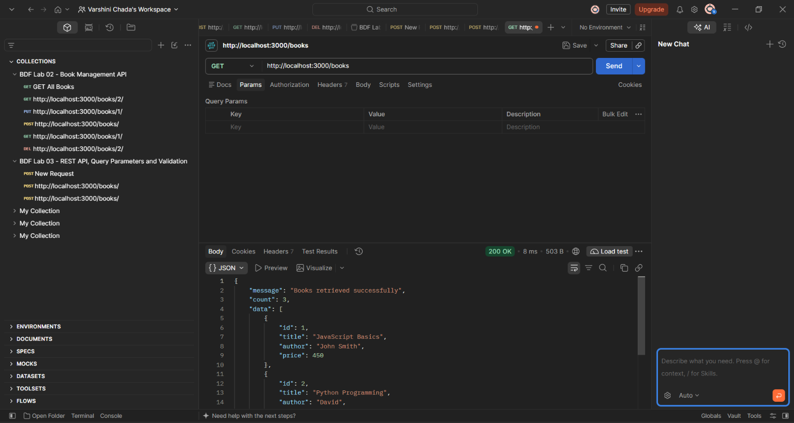

### 6.2 GET Pagination

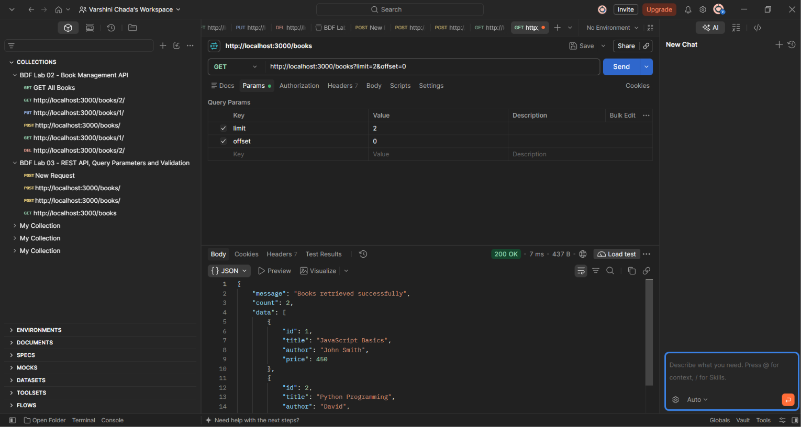

### 6.3 GET Price Filter

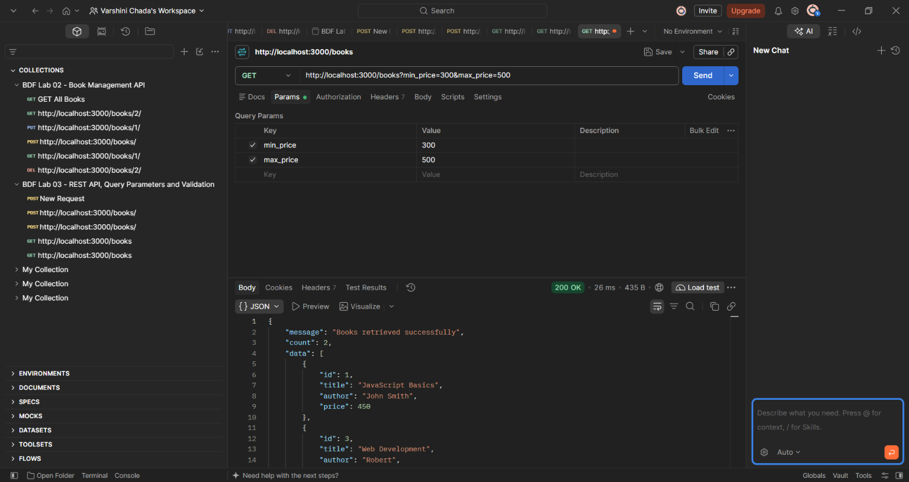

### 6.4 GET Search Books

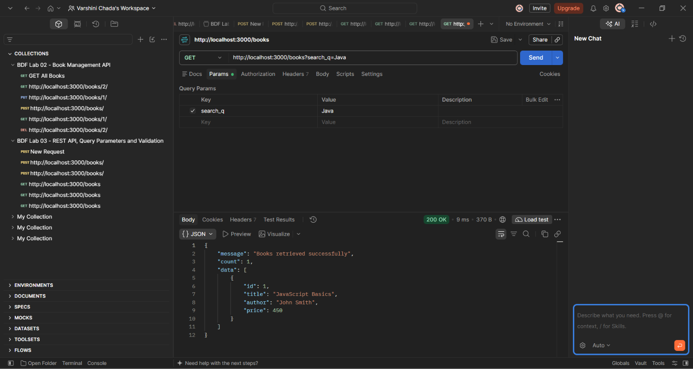

### 6.5 GET Sorting

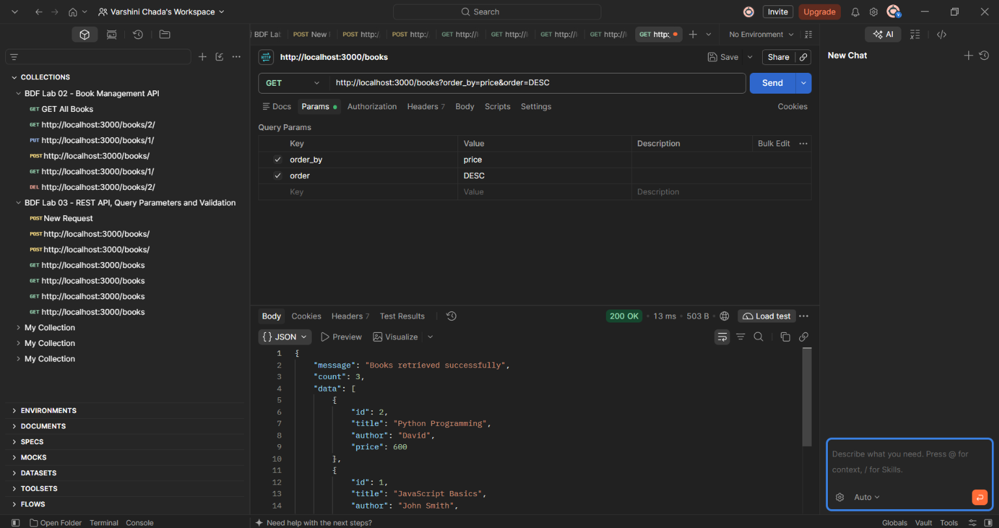

### 6.6 Invalid Maximum Price

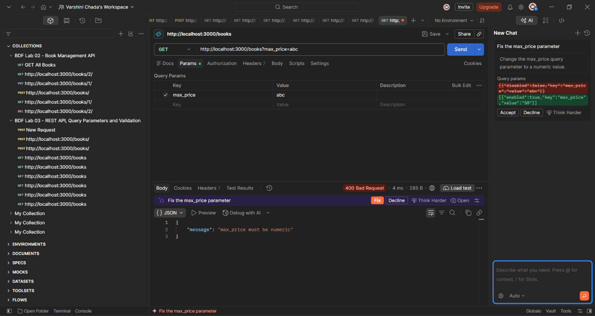

### 6.7 Invalid Minimum Price

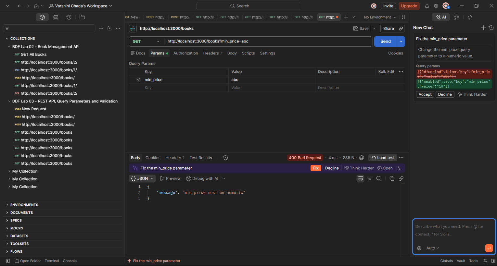

### 6.8 Invalid Price Range

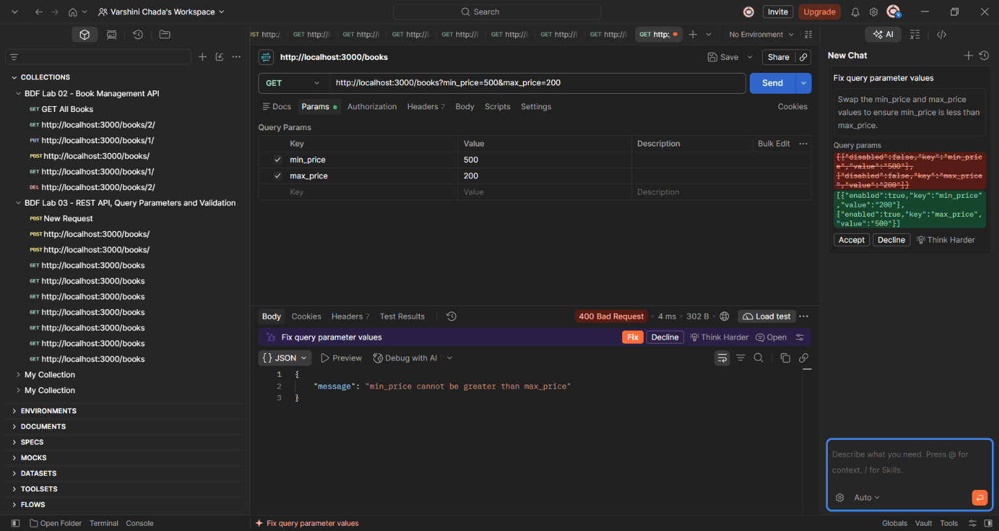

### 6.9 POST Create Book

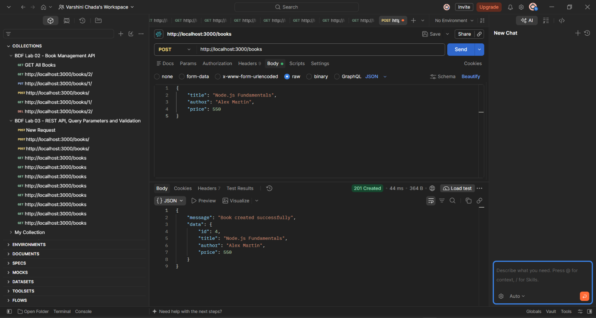

### 6.10 POST Validation Error

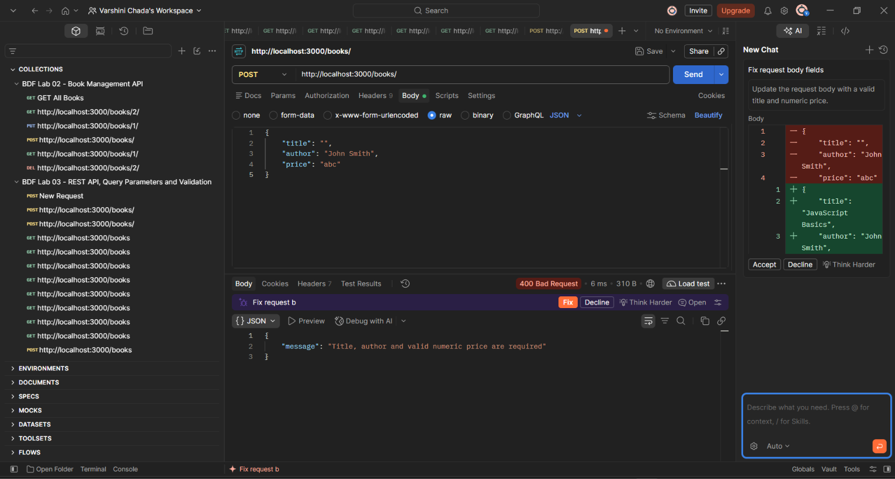

### 6.11 PUT Update Book

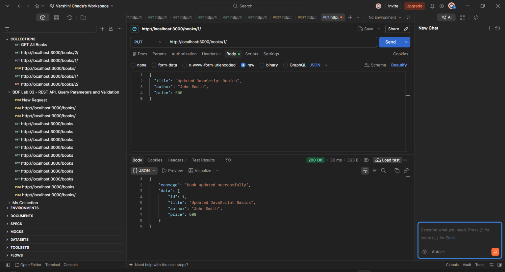

### 6.12 DELETE Book

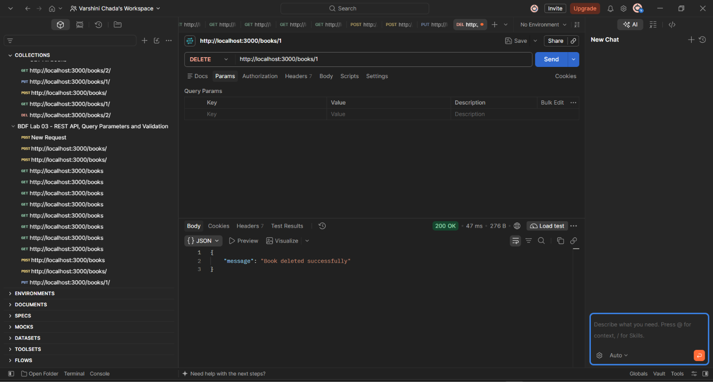

### 6.13 DELETE Not Found

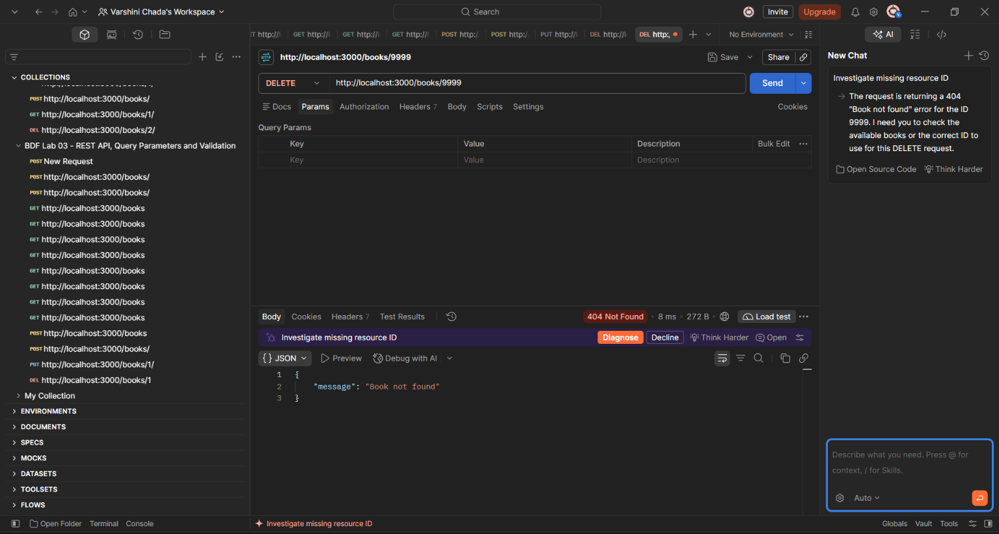

## 7. Postman Collection

The Postman collection containing all API requests is available in the `postman/` folder.

## 8. Learning Outcomes

- Understanding REST API architecture.
- Working with HTTP methods and status codes.
- Performing CRUD operations.
- Handling JSON requests and responses.
- Implementing query parameters.
- Validating user inputs.
- Testing APIs using Postman.

## 9. Conclusion

This lab helped me understand RESTful API development using Node.js and Express.js. I learned how to implement CRUD operations, handle query parameters, perform validation, and test API endpoints using Postman.